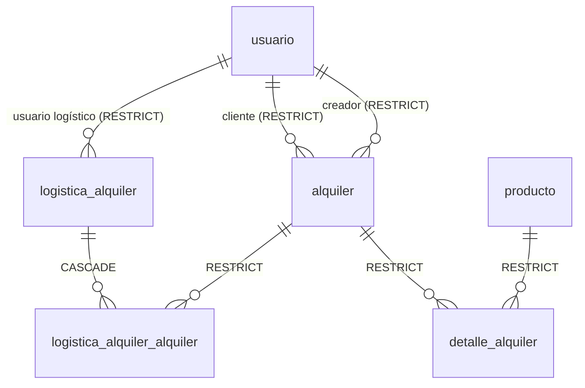

# 03 — Relaciones y restricciones

Fuente: `pg_constraint`, `pg_indexes` y consultas de integridad de solo lectura sobre `sga_db`.

## 1. Claves primarias (8)

| Tabla | Restricción | Columnas |
|---|---|---|
| `alembic_version` | `alembic_version_pkc` |  (version_num) |
| `alquiler` | `alquiler_pkey` |  (id_alquiler) |
| `auditoria_sistema` | `auditoria_sistema_pkey` |  (id_auditoria) |
| `detalle_alquiler` | `detalle_alquiler_pkey` |  (id_detalle_alquiler) |
| `logistica_alquiler` | `logistica_alquiler_pkey` |  (id_logistica_alquiler) |
| `logistica_alquiler_alquiler` | `logistica_alquiler_alquiler_pkey` |  (id_logistica_alquiler, id_alquiler) |
| `producto` | `producto_pkey` |  (id_producto) |
| `usuario` | `usuario_pkey` |  (id_usuario) |

## 2. Claves foráneas (7)

Todas las FK usan `ON UPDATE CASCADE`. `ON DELETE` es `RESTRICT` salvo en la tabla puente, donde `fk_logalq_logistica` usa `ON DELETE CASCADE`.

| Tabla hija | Restricción | Definición |
|---|---|---|
| `alquiler` | `fk_alquiler_usuario_cliente` |  (id_usuario_cliente) REFERENCES usuario(id_usuario) ON UPDATE CASCADE ON DELETE RESTRICT |
| `alquiler` | `fk_alquiler_usuario_creador` |  (id_usuario_creador) REFERENCES usuario(id_usuario) ON UPDATE CASCADE ON DELETE RESTRICT |
| `detalle_alquiler` | `fk_detalle_alquiler_alquiler` |  (id_alquiler) REFERENCES alquiler(id_alquiler) ON UPDATE CASCADE ON DELETE RESTRICT |
| `detalle_alquiler` | `fk_detalle_alquiler_producto` |  (id_producto) REFERENCES producto(id_producto) ON UPDATE CASCADE ON DELETE RESTRICT |
| `logistica_alquiler` | `fk_logistica_usuario` |  (id_usuario_logistico) REFERENCES usuario(id_usuario) ON UPDATE CASCADE ON DELETE RESTRICT |
| `logistica_alquiler_alquiler` | `fk_logalq_alquiler` |  (id_alquiler) REFERENCES alquiler(id_alquiler) ON UPDATE CASCADE ON DELETE RESTRICT |
| `logistica_alquiler_alquiler` | `fk_logalq_logistica` |  (id_logistica_alquiler) REFERENCES logistica_alquiler(id_logistica_alquiler) ON UPDATE CASCADE ON DELETE CASCADE |

### Mapa de relaciones

## 3. Restricciones UNIQUE (2)

| Tabla | Restricción | Columnas |
|---|---|---|
| `usuario` | `usuario_email_usuario_key` |  (email_usuario) |
| `usuario` | `usuario_telefono_usuario_key` |  (telefono_usuario) |

Además existen dos **índices únicos parciales** que no aparecen como restricciones `UNIQUE`:
- `detalle_alquiler.idx_unico_producto_alquiler` sobre `(id_alquiler, id_producto)` con `WHERE es_producto_extra = false`.
- `alembic_version.alembic_version_pkc` sobre `(version_num)` (respaldada por la PK).

## 4. Restricciones CHECK (16)

| Tabla | Restricción | Expresión |
|---|---|---|
| `alquiler` | `chk_alquiler_deposito` |  ((deposito >= (0)::numeric)) |
| `alquiler` | `chk_alquiler_estado` |  (((estado_alquiler)::text = ANY ((ARRAY['pendiente'::character varying, 'activo'::character varying, 'vencido'::character varying, 'recogido'::character varying, 'terminado'::character varying, 'cancelado'::character varying])::text[]))) |
| `alquiler` | `chk_alquiler_precio` |  ((precio_alquiler >= (0)::numeric)) |
| `alquiler` | `chk_alquiler_tiempo_dias` |  ((tiempo_alquiler_dias > 0)) |
| `auditoria_sistema` | `chk_auditoria_operacion` |  (((tipo_operacion)::text = ANY ((ARRAY['INSERT'::character varying, 'UPDATE'::character varying, 'DELETE'::character varying])::text[]))) |
| `detalle_alquiler` | `chk_detalle_cantidad` |  ((cantidad_productos > 0)) |
| `detalle_alquiler` | `chk_detalle_precio_conjunto` |  ((precio_conjunto >= (0)::numeric)) |
| `logistica_alquiler` | `chk_logistica_tipo_movimiento` |  (((tipo_movimiento)::text = ANY ((ARRAY['ENTREGA'::character varying, 'RECOGIDA'::character varying, 'GASTO'::character varying])::text[]))) |
| `logistica_alquiler` | `chk_logistica_valor_gasto` |  ((valor_gasto_logistico >= (0)::numeric)) |
| `producto` | `chk_producto_precio` |  ((precio_base_producto >= (0)::numeric)) |
| `producto` | `chk_producto_precio_extra` |  ((precio_base_extra >= (0)::numeric)) |
| `producto` | `chk_producto_stock_alquilado` |  (((stock_alquilado >= 0) AND (stock_alquilado <= stock_total))) |
| `producto` | `chk_producto_stock_total` |  ((stock_total >= 0)) |
| `producto` | `chk_producto_unidad_minima_alquiler` |  (((unidad_minima_alquiler)::text = ANY ((ARRAY['DIA'::character varying, 'SEMANA'::character varying, 'MES'::character varying])::text[]))) |
| `usuario` | `chk_usuario_rol` |  (((rol_usuario)::text = ANY ((ARRAY['admin'::character varying, 'encargado_facturacion'::character varying, 'encargado_logistico'::character varying, 'cliente'::character varying])::text[]))) |
| `usuario` | `chk_usuario_tipo_documento` |  (((tipo_documento)::text = ANY ((ARRAY['CC'::character varying, 'CE'::character varying, 'NIT'::character varying, 'PPT'::character varying])::text[]))) |

## 5. Restricciones NOT NULL (59)

Se declararon 59 restricciones `NOT NULL` (incluida la de `alembic_version.version_num`). Las columnas opcionales son: `usuario.email_usuario`, `usuario.contrasena_usuario`, `producto.descripcion_producto`, `logistica_alquiler.descripcion_gasto_logistico`, `logistica_alquiler.observaciones_logistica_alquiler` y `auditoria_sistema.datos_anteriores/datos_nuevos/id_usuario_accion`. El detalle columna a columna está en `02_inventario_tablas_y_columnas.md`.

## 6. Índices (26)

| Tabla | Índice | Definición |
|---|---|---|
| `alembic_version` | `alembic_version_pkc` | `CREATE UNIQUE INDEX alembic_version_pkc ON public.alembic_version USING btree (version_num)` |
| `alquiler` | `alquiler_pkey` | `CREATE UNIQUE INDEX alquiler_pkey ON public.alquiler USING btree (id_alquiler)` |
| `alquiler` | `idx_alquiler_cliente` | `CREATE INDEX idx_alquiler_cliente ON public.alquiler USING btree (id_usuario_cliente)` |
| `alquiler` | `idx_alquiler_creador` | `CREATE INDEX idx_alquiler_creador ON public.alquiler USING btree (id_usuario_creador)` |
| `alquiler` | `idx_alquiler_estado` | `CREATE INDEX idx_alquiler_estado ON public.alquiler USING btree (estado_alquiler) WHERE (estado_registro IS TRUE)` |
| `alquiler` | `idx_alquiler_fecha_inicio` | `CREATE INDEX idx_alquiler_fecha_inicio ON public.alquiler USING btree (fecha_inicio)` |
| `alquiler` | `idx_alquiler_fecha_vencimiento` | `CREATE INDEX idx_alquiler_fecha_vencimiento ON public.alquiler USING btree ((((fecha_inicio + tiempo_alquiler_dias) - 1)))` |
| `auditoria_sistema` | `auditoria_sistema_pkey` | `CREATE UNIQUE INDEX auditoria_sistema_pkey ON public.auditoria_sistema USING btree (id_auditoria)` |
| `auditoria_sistema` | `idx_auditoria_fecha` | `CREATE INDEX idx_auditoria_fecha ON public.auditoria_sistema USING btree (fecha_accion)` |
| `auditoria_sistema` | `idx_auditoria_tabla_registro` | `CREATE INDEX idx_auditoria_tabla_registro ON public.auditoria_sistema USING btree (nombre_tabla, id_registro_afectado)` |
| `auditoria_sistema` | `idx_auditoria_usuario` | `CREATE INDEX idx_auditoria_usuario ON public.auditoria_sistema USING btree (id_usuario_accion) WHERE (id_usuario_accion IS NOT NULL)` |
| `detalle_alquiler` | `detalle_alquiler_pkey` | `CREATE UNIQUE INDEX detalle_alquiler_pkey ON public.detalle_alquiler USING btree (id_detalle_alquiler)` |
| `detalle_alquiler` | `idx_detalle_alquiler_id` | `CREATE INDEX idx_detalle_alquiler_id ON public.detalle_alquiler USING btree (id_alquiler)` |
| `detalle_alquiler` | `idx_detalle_producto_id` | `CREATE INDEX idx_detalle_producto_id ON public.detalle_alquiler USING btree (id_producto)` |
| `detalle_alquiler` | `idx_unico_producto_alquiler` | `CREATE UNIQUE INDEX idx_unico_producto_alquiler ON public.detalle_alquiler USING btree (id_alquiler, id_producto) WHERE (es_producto_extra = false)` |
| `logistica_alquiler` | `idx_logistica_usuario` | `CREATE INDEX idx_logistica_usuario ON public.logistica_alquiler USING btree (id_usuario_logistico)` |
| `logistica_alquiler` | `logistica_alquiler_pkey` | `CREATE UNIQUE INDEX logistica_alquiler_pkey ON public.logistica_alquiler USING btree (id_logistica_alquiler)` |
| `logistica_alquiler_alquiler` | `idx_logalq_alquiler` | `CREATE INDEX idx_logalq_alquiler ON public.logistica_alquiler_alquiler USING btree (id_alquiler)` |
| `logistica_alquiler_alquiler` | `logistica_alquiler_alquiler_pkey` | `CREATE UNIQUE INDEX logistica_alquiler_alquiler_pkey ON public.logistica_alquiler_alquiler USING btree (id_logistica_alquiler, id_alquiler)` |
| `producto` | `idx_producto_nombre` | `CREATE INDEX idx_producto_nombre ON public.producto USING btree (nombre_producto) WHERE (estado_registro IS TRUE)` |
| `producto` | `producto_pkey` | `CREATE UNIQUE INDEX producto_pkey ON public.producto USING btree (id_producto)` |
| `usuario` | `idx_usuario_email` | `CREATE INDEX idx_usuario_email ON public.usuario USING btree (email_usuario) WHERE (email_usuario IS NOT NULL)` |
| `usuario` | `idx_usuario_rol` | `CREATE INDEX idx_usuario_rol ON public.usuario USING btree (rol_usuario) WHERE (estado_registro IS TRUE)` |
| `usuario` | `usuario_email_usuario_key` | `CREATE UNIQUE INDEX usuario_email_usuario_key ON public.usuario USING btree (email_usuario)` |
| `usuario` | `usuario_pkey` | `CREATE UNIQUE INDEX usuario_pkey ON public.usuario USING btree (id_usuario)` |
| `usuario` | `usuario_telefono_usuario_key` | `CREATE UNIQUE INDEX usuario_telefono_usuario_key ON public.usuario USING btree (telefono_usuario)` |

## 7. Verificación de huérfanos

Consulta: `LEFT JOIN` de cada tabla hija contra su padre por las columnas de la FK, filtrando valores no nulos.

| Tabla hija | Restricción | Padre | Filas huérfanas |
|---|---|---|---:|
| `alquiler` | `fk_alquiler_usuario_cliente` | usuario | 0 |
| `alquiler` | `fk_alquiler_usuario_creador` | usuario | 0 |
| `detalle_alquiler` | `fk_detalle_alquiler_alquiler` | alquiler | 0 |
| `detalle_alquiler` | `fk_detalle_alquiler_producto` | producto | 0 |
| `logistica_alquiler` | `fk_logistica_usuario` | usuario | 0 |
| `logistica_alquiler_alquiler` | `fk_logalq_alquiler` | alquiler | 0 |
| `logistica_alquiler_alquiler` | `fk_logalq_logistica` | logistica_alquiler | 0 |

Resultado: **0 filas huérfanas en las 7 foreign keys**. No se encontraron claves duplicadas que vulneren las restricciones `UNIQUE` (el motor las garantiza) ni índices inválidos.

## 8. Reglas de integridad implementadas fuera de restricciones declarativas

Además de PK/FK/CHECK/UNIQUE, la integridad de negocio depende de los triggers documentados en `04_funciones_triggers_y_vistas.md`: control de stock, validación de fechas, inmutabilidad de productos de una línea, estado de usuario, cierre de alquileres y auditoría. Estas reglas **no** están representadas en `pg_constraint` y, por tanto, no se crean con la migración Alembic actual.
